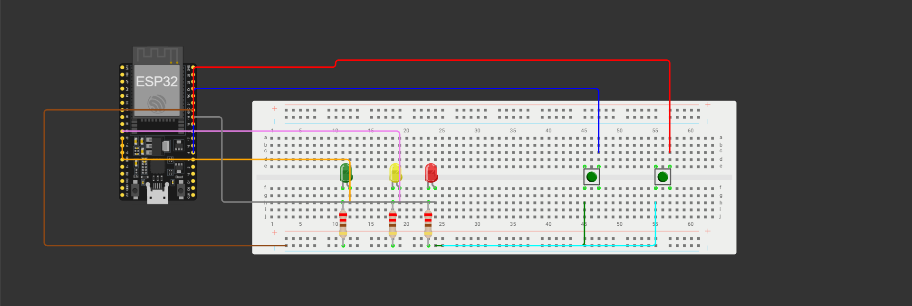

# LEDs and Buttons

My first experiments with ESP32 and C++.

A small project where I played around with LEDs, push buttons, and GPIO pins. Nothing too complicated, just learning how things work and getting some hands-on experience with hardware.

### What it does
- Blinks an LED three times in a loop.
- Turns an LED on while a button is held.
- Toggles another LED on and off with each button press.

### Hardware
- ESP32 DevKit
- 3 LEDs
- 2 push buttons
- Current-limiting resistors (220 Ω)
- Breadboard and jumper wires

Just a small step forward in learning embedded programming. More experiments coming soon.

# Scheme

