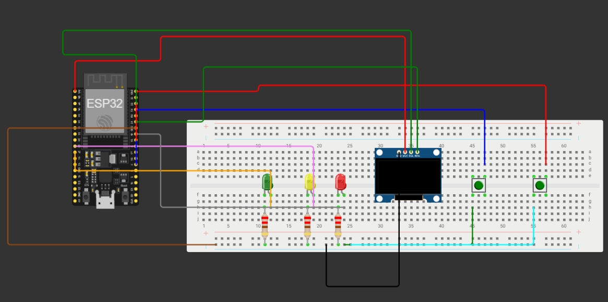

# ESP32 LED Panel

A small ESP32 project with an OLED display, LEDs, and physical buttons. Built with C++ using the Arduino framework.

## Features

- OLED interface (128×64, SSD1306)
- LED control with physical buttons
- Button press detection and state toggling
- Non-blocking LED blinking using `millis()`
- Live status display for LEDs, buttons, and the current stage

## Hardware

- ESP32 DevKit V1
- SSD1306 OLED display (0.96", I²C)
- 3 LEDs
- 2 push buttons
- Resistors and jumper wires

## Pinout

| Component | ESP32 GPIO |
|---|---:|
| LED 1 | 27 |
| LED 2 | 26 |
| LED 3 | 19 |
| Button 1 | 4 |
| Button 2 | 18 |
| OLED SDA | 21 |
| OLED SCL | 22 |

Buttons use `INPUT_PULLUP`, so they are connected between the GPIO pins and GND.

## Libraries

- [U8g2](https://github.com/olikraus/u8g2)
- Wire (included with the Arduino framework)

## Concepts

- Functions and variables in C++
- Boolean logic and ternary operators
- Reading digital inputs
- Tracking button state changes
- Non-blocking timing with `millis()`
- Displaying formatted text with `snprintf()`

## Wiring

